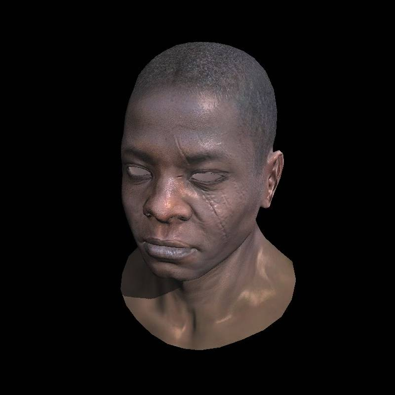
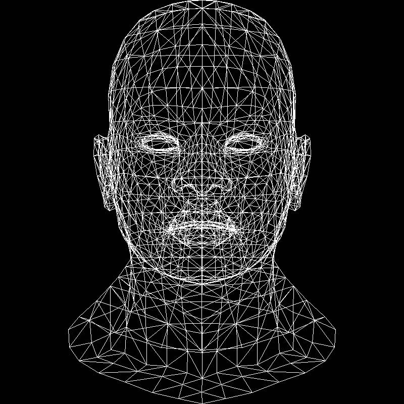
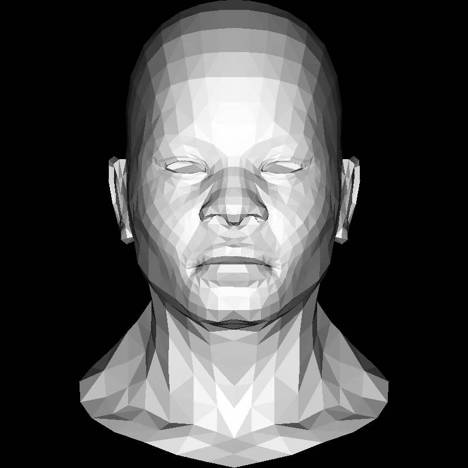
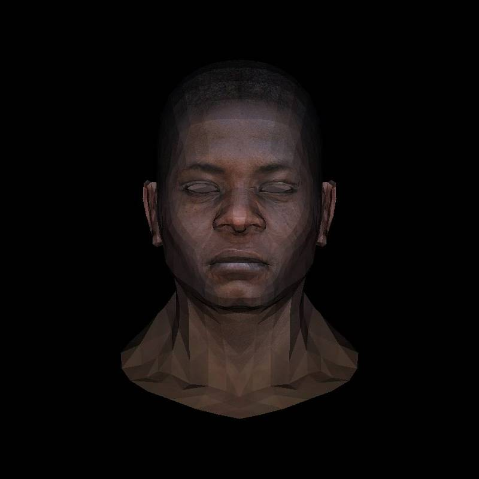
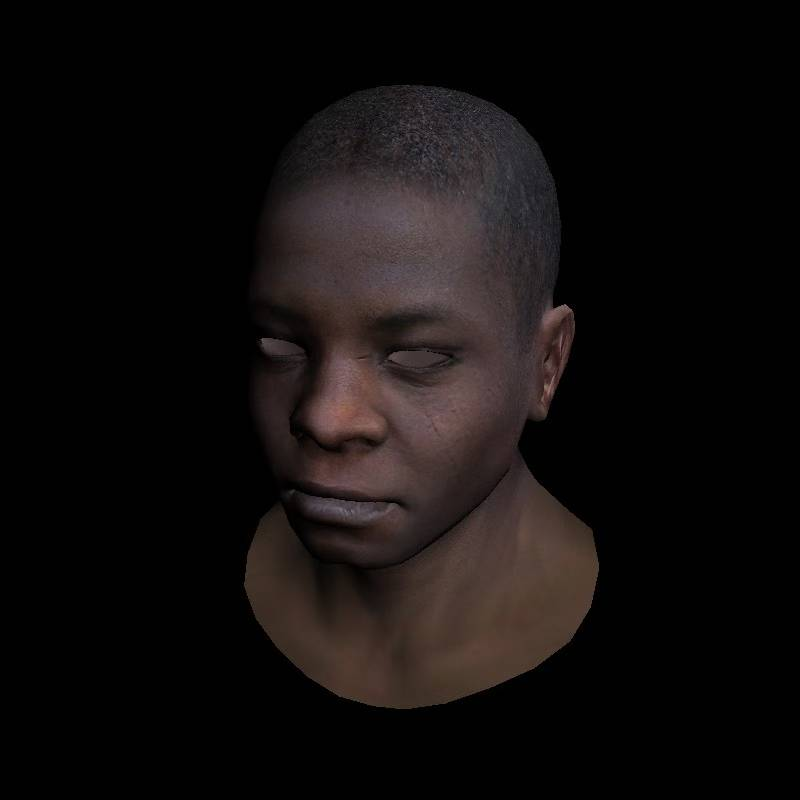
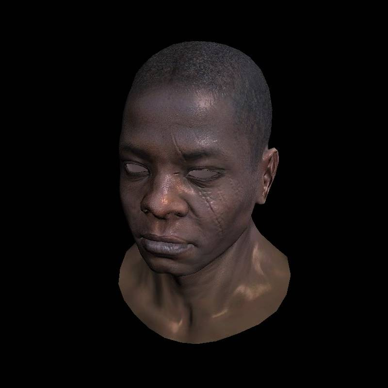
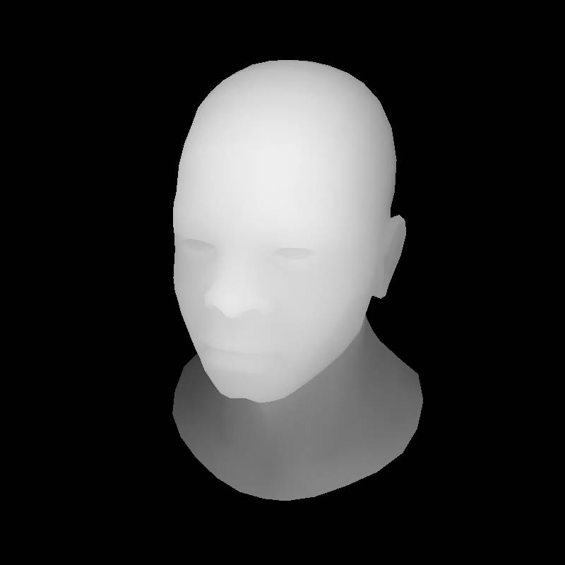

# My TinyRenderer

C++ 实现的软件光栅化渲染器。

直线、三角形，纹理、光照、阴影等。

渲染结果输出为 TGA 图片。

下面为保存在 `picture/` 中的 JPG 图。

## Picture

### 07 · Shadow

### 01 · Line

### 02 · Triangle

### 03 · UV

通过 UV 坐标将纹理映射到模型表面。

### 04 · Interpolation

### 05 · Light

### 06 · Z-buffer

